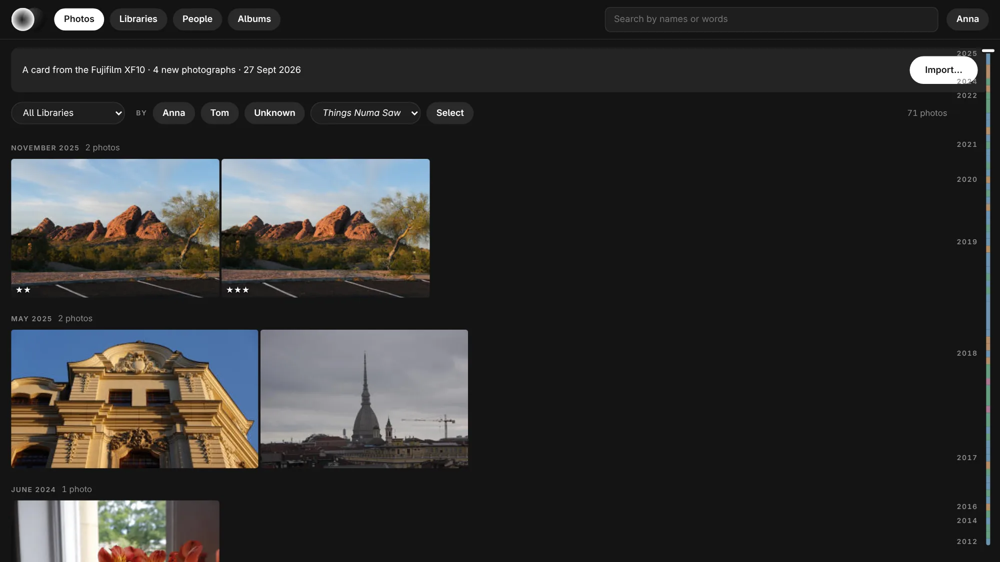
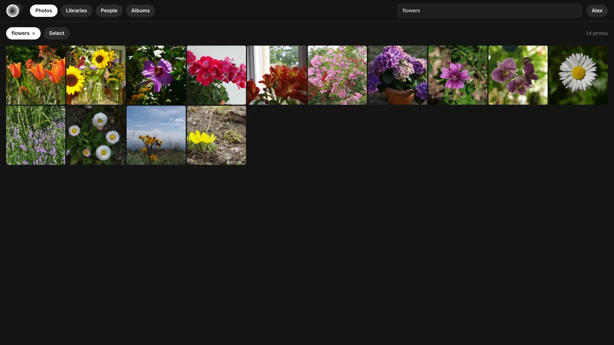
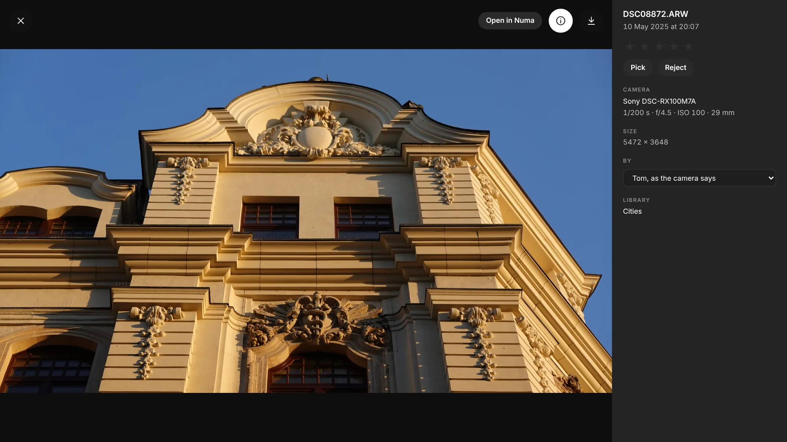
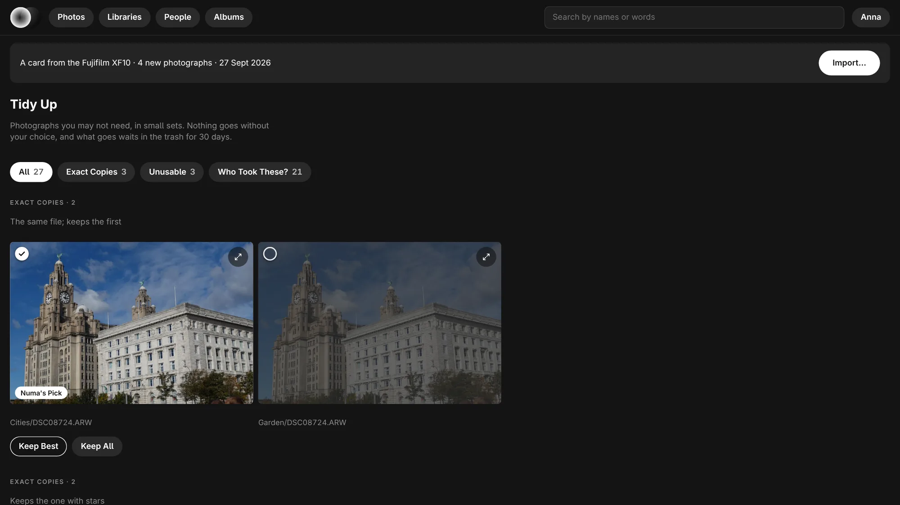
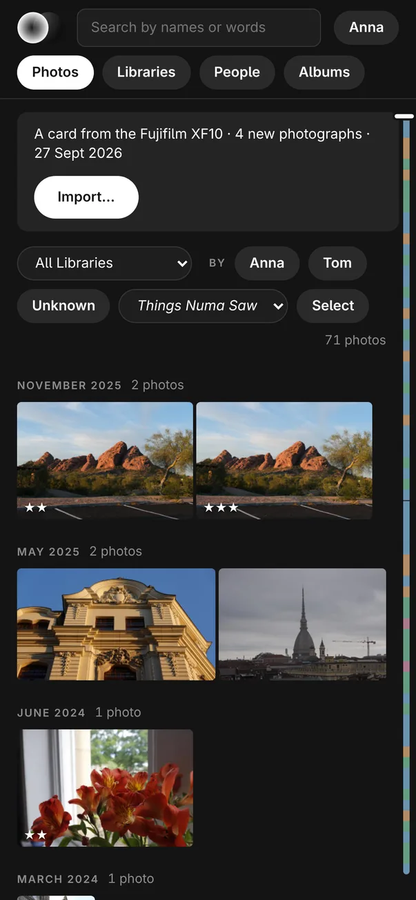

# Numa Home

**Your household's photographs, at home.** Numa Home runs on your own NAS
and shows every photograph in the house in a browser: on the sofa, on a
phone, on the TV. Raws look the way [Numa](https://github.com/simmmmm/Numa)
develops them, with your edits on them. Faces and words are found the way
the Numa app finds them, on your NAS. Nothing goes to the cloud.

One container. No database server, no separate machine-learning container.



More on [numa.photo/numa-home](https://numa.photo/numa-home), and every page
explained in [the guide](https://guide.numa.photo/numa-home).

## What it does

- **A timeline of everything.** Every month in one scroll, with a scrubber
  on the right that shows where each trip is.
- **Raws, developed.** RAF, ARW, CR3, NEF, DNG and the rest, rendered with
  Numa's colour and your edits. Not the camera's small preview.
- **People.** Faces are found and grouped. Name them once and they are found
  everywhere.
- **Search in words.** Type "beach at sunset", "reiger" or "Anna and Tom in
  the snow", in English or Dutch.
- **The whole household.** An account for each person. Filter by who took a
  photograph. Albums, stars and picks are shared.
- **Send Home.** The Numa apps send photographs home: from Linux and the
  Mac's export dialog as a JPEG or as the original with its edits, and from
  the iPhone the whole Photos library, quietly, on Wi-Fi and while charging.
  The same photograph sent twice is kept once.
- **Back into Numa.** Bring a library from Home into Numa on your computer,
  edit it there, and it stays in step with Home both ways.
- **An SD card in the NAS.** Put a card in and import from the browser,
  checked file by file. Each shoot goes to the trip it belongs to, or to a
  new folder you name.
- **Your archive as it is.** Point it at the folders you already have. A
  library made by the Numa app keeps its stars, edits and names.

<table>
<tr>
<td width="50%"></td>
<td width="50%"></td>
</tr>
<tr>
<td width="50%"></td>
<td width="50%" align="center"></td>
</tr>
</table>

## Install

Numa Home is a Docker image for x86-64: `ghcr.io/simmmmm/numa-home`.

1. Put [`compose.yaml`](compose.yaml) in a folder and change the left side
   of each volume to where things live on your machine: `/photos` is the
   folder that holds your photographs, `/sent` and `/data` are folders of
   its own.
2. Start it:

   ```sh
   docker compose up -d
   ```

   On a NAS with a Docker app (UGREEN, Synology, QNAP, Unraid, Portainer),
   create a project or stack and paste the same file.
3. Set `TZ` to your time zone (for example `Europe/Berlin`): the night
   shift, when Numa Home catches up and checks everything, runs from 01:00
   to 06:00 in it.
4. Open `http://<host>:8283` and make the first account. It can make one
   for everyone else.

On the first start the face and search models are downloaded (about
520 MB) into `/data`. The photographs are then read in the background, on
at most half the processor. The Activity page shows how far it has got and
can pause it.

**Updating:** pull the image again and restart. Accounts, names and
everything already read stay in `/data`.

### SD cards and USB drives

To import cards from the browser, add the folder where the host mounts
removable drives as `/cards`, read only, with `rslave` propagation so a
card put in later shows up:

```yaml
      - type: bind
        source: /media
        target: /cards
        read_only: true
        bind:
          propagation: rslave
```

### The Intel iGPU

Optional, for faster decoding: `devices: ["/dev/dri:/dev/dri"]`.

## Good to know

- **Port 8283** on your own network. To reach it from outside, use a
  reverse proxy or a VPN such as Tailscale. Numa Home does not expose
  itself.
- **One writer.** Numa Home keeps a small catalog inside each library's
  `.numa` folder. Don't open those same folders over the network in the Numa
  app at the same time; use Send Home and Numa Home libraries instead. Two
  programs writing one database over SMB can damage it.
- **No video yet.** Photographs only, for now.

## Source and licence

Numa Home is part of [Numa](https://github.com/simmmmm/Numa), a raw
developer for Linux, the iPhone, the iPad and the Mac. Its source is there,
under the GPL 3.0 or later. Each image is built from that repository's
release tag of the same version. The models keep their own licences, listed
in Numa's `THIRD_PARTY_LICENSES.txt`.
